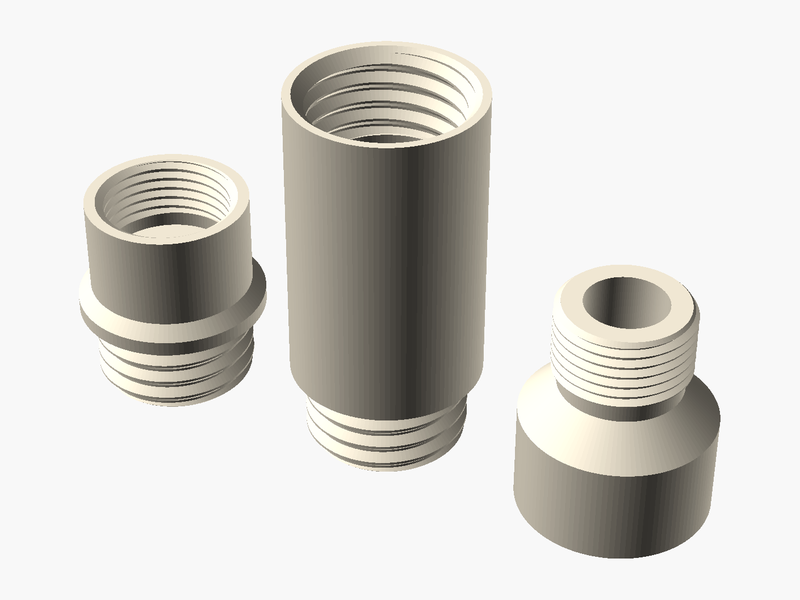

# Modular Water Filter

**Created by:** Artham

GWFS is a filtration system for your gutters made up of three components. At the top there is an attachment that connects to your gutter with a hose. The next component is a tubular cylinder where the bottom part is a sieve that attaches to a coupler that, in turn attaches to your hose. The point of the invention is that instead of using city water when using your hose and adding money to your water bill you can use this filter and put rain water to use and avoid paying more money and also conserving water.

## Printed with PHA 🌱

**What is PHA?** PHA is a plastic made by tiny microbes! They munch on plant sugars and oils and store the PHA inside their bodies, kind of like how we store energy.

**Why is it eco-friendly?** It comes from plants instead of oil. And when it's all done, it can break down back into nature (in soil, and even in the ocean) instead of hanging around for hundreds of years.

**Printing tips:**
- 🧊 **Keep it cool:** set the nozzle to about 190–200 °C.
- 💨 **Lots of air:** turn the cooling fan up high and leave the printer doors or lid open.
- 🐢 **Go a little slower:** slower prints help each layer stick and cool nicely.
- ☀️ **Keep it dry:** store the spool in a bag with a desiccant pack so it doesn't soak up water.
